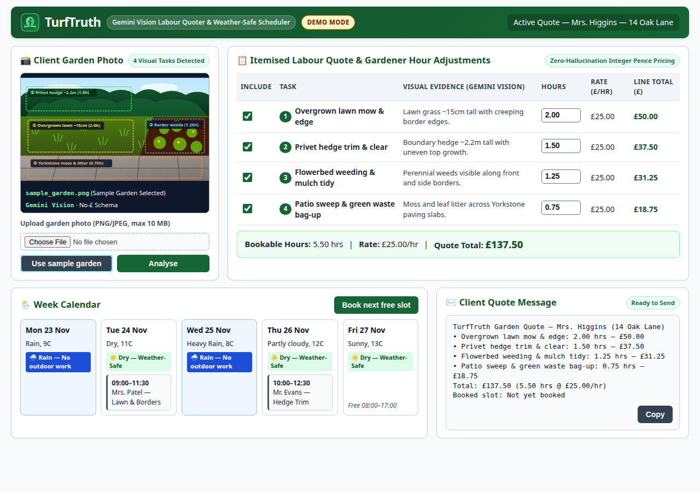

#  TurfTruth

**Turn client garden photos into itemised, zero-hallucination labour quotes and book the next weather-safe slot in one click.**

> 🏆 **Winner: 1st place out of 100+ teams** at the Google Cloud mini-hackathon *"Beyond vibes: how to use AI to build production-ready software"* (18 November 2026).
>
> Teams had three hours to start a business and build its web app with Antigravity and the latest Gemini models on a Google Cloud desktop, scored live on a leaderboard by "Judge Gemini" against each team's own product brief and acceptance criteria.

TurfTruth is a lightweight web application for independent gardeners and landscaping crews. Upload a client's garden photo (or try the built-in sample garden) and TurfTruth uses Google Gemini with a constrained Pydantic `response_schema` to identify visible maintenance tasks, estimate labour hours, and cite visual evidence from the photo—while computing every penny of pricing deterministically in Python and JavaScript. Gardeners can tick or untick tasks, fine-tune hours in `0.25h` steps with instant total updates, book the job into the earliest rain-free gap in their working week, and copy a ready-to-send client quote message.



---

## Quickstart (One Command — No API Key Needed)

TurfTruth runs out of the box in deterministic **`DEMO_MODE`** when `GEMINI_API_KEY` is unset:

```bash
make run
```

Or run `uvicorn` directly with `uv`:

```bash
DEMO_MODE=1 UV_PYTHON=3.14 uv run uvicorn main:app --host 0.0.0.0 --port 8080
```

Then open **[http://localhost:8080](http://localhost:8080)** in your browser:
1. Click **Use sample garden** (`[data-testid="sample-btn"]`) and press **Analyse** (`[data-testid="analyse-btn"]`).
2. Adjust task checkboxes or hours (`0.25h` steps) and watch line costs and the grand total update immediately.
3. Click **Book next free slot** (`[data-testid="book-btn"]`) to place the job into the earliest contiguous dry-day gap on the week calendar.
4. Click **Copy** (`[data-testid="copy-btn"]`) to copy the formatted client quote and booking confirmation to your clipboard.

---

## Using a Real `GEMINI_API_KEY`

To run live vision analysis against Google Gemini (`gemini-2.5-flash` via the `google-genai` SDK):

1. Copy `.env.example` to `.env` (or export variables in your shell):
   ```bash
   cp .env.example .env
   ```
2. Set your API key and disable demo mode:
   ```bash
   GEMINI_API_KEY="your-google-gemini-api-key" \
   DEMO_MODE=0 \
   HOURLY_RATE_PENCE=2500 \
   UV_PYTHON=3.14 uv run uvicorn main:app --host 0.0.0.0 --port 8080
   ```
3. Verify live mode via `GET /health`:
   ```bash
   curl -s http://localhost:8080/health
   # {"status":"ok","mode":"live","prompt_version":"analyse_v1"}
   ```

---

## Running Tests, Linting & Evals

All commands automatically target Python 3.14 (`UV_PYTHON=3.14`) and work offline with no API key required:

```bash
# Install / sync environment
make install

# Run unit + FastAPI TestClient API tests
make test

# Run Playwright Chromium end-to-end browser tests (test_c1 .. test_c5 + edge cases)
make e2e

# Run Ruff linter across the repository
make lint

# Run vision pipeline evaluation harness (3 runs x 5 labeled images -> evals/RESULTS.md)
make evals
```

---

## Architecture & Contract Summary

```text
Browser -> FastAPI -> Gemini + Pydantic Schema -> Sanitiser -> Pricing/Scheduler in Code
+---------+    /api/analyse    +---------+   response_schema   +--------------------------+
| Browser | -----------------> | FastAPI | ------------------> | Gemini + Pydantic Schema |
+---------+ <----------------- +---------+ <------------------ +--------------------------+
     |         tasks / slot         ^         Sanitiser (0.25..40h, cap 12, t1..tN)
     +------> Pricing/Scheduler in Code (`pricing.py` integer pence + `scheduler.py` slots)
```

### Key Contract Boundaries (`CONTRACT.md`)
- **`ai.py` (`PROMPT_VERSION = "analyse_v1"`)**: Passes `RawGardenAnalysis(is_garden: bool, tasks: list[RawTaskEstimate(name, hours, evidence)])` to Gemini (or loads SHA-256 matched fixtures in `DEMO_MODE`) and runs `sanitise_analysis` to clamp hours to `[0.25, 40.0]` rounded to `0.25h`, drop blank tasks, cap at 12 tasks, and assign stable IDs `t1..tN`.
- **`pricing.py` & `static/app.js`**: Pure integer-pence functions `line_cost_pence(hours, rate_pence)` (`ROUND_HALF_UP`) and `total_pence(tasks, rate_pence)` using `HOURLY_RATE_PENCE` (default `2500` = `£25.00/hr`).
- **`scheduler.py`**: Pure function `find_next_slot(duration_hours, week, working_hours)` scanning `data/mock_calendar.json` (`08:00–17:00`), skipping any `rain: true` days, respecting existing bookings (touching edges `end == start` allowed), and returning the earliest contiguous slot.
- **HTTP Endpoints (`main.py`)**:
  - `POST /api/analyse` — validates image upload (missing -> `400 no_file`, non-image -> `400 invalid_image`, >10 MB -> `400 file_too_large`, timeout -> `504 ai_timeout`, upstream/schema -> `502`) and returns sanitised tasks.
  - `GET /api/calendar` — returns the 5-day week schedule (`date`, `label`, `rain`, `bookings`) and `working_hours`.
  - `POST /api/book` — validates `hours > 0`, finds and records the earliest dry-day slot, and returns `{slot, message}`.
  - `GET /health` — returns `{status: "ok", mode: "demo"|"live", prompt_version: "analyse_v1"}`.

---

## Why Zero-Hallucination Pricing?

Allowing an LLM to output currency figures, multiply hours by hourly rates, or sum quote totals creates three failure modes in production quoting tools:
1. **Arithmetic drift**: LLM line items frequently fail to sum to the stated grand total or misapply fractional hours (`1.75h × £25.00`).
2. **Rate lock-in**: Hardcoding £ rates inside prompts prevents gardeners from changing their hourly rate (`HOURLY_RATE_PENCE`) without re-running paid vision inference.
3. **Unverifiable quotes**: Clients and gardeners cannot tell how a lump-sum figure was derived.

In TurfTruth, **Gemini estimates work only (`name`, `hours`, `evidence`)**. The Pydantic schema passed to Gemini contains zero price, cost, rate, or currency fields. Every monetary figure is computed deterministically in integer pence by `pricing.py` (and its single mirrored helper in `static/app.js`), guaranteeing that `line_cost = round_half_up(hours × HOURLY_RATE_PENCE)` and `total = sum(ticked line_costs)` to the exact penny every time.

---

## Acceptance Criteria (`C1`–`C5`)

| Criterion | Description | Automated Test | Browser Check | Status |
|---|---|---|---|---|
| **C1** | Clicking **Use sample garden** -> **Analyse** populates `>= 3` gardening tasks without page reload, each showing editable hours, £ line cost, and visual evidence note. | `tests/e2e/test_e2e.py::test_c1_sample_analysis` | `tests/screenshots/c1_sample_analysis.png` | `PASS` |
| **C2** | Editing a task's hours or unticking a task immediately updates line cost and `[data-testid="total"]` to equal `ticked hours × hourly rate` to the penny. | `tests/e2e/test_e2e.py::test_c2_live_total` | `tests/screenshots/c2_live_total.png` | `PASS` |
| **C3** | Pressing **Analyse** with no photo or uploading `tests/not_a_garden.png` displays a clean inline `[data-testid="error-msg"]` and renders `0` task rows. | `tests/e2e/test_e2e.py::test_c3_empty_and_non_garden` | `tests/screenshots/c3_empty_and_non_garden.png` | `PASS` |
| **C4** | Clicking **Book next free slot** places `[data-testid="booked-slot"]` into the earliest contiguous gap on `[data-testid="calendar"]` with zero overlap against `[data-testid="existing-booking"]` and never on a `[data-testid="rain-day"]`. | `tests/e2e/test_e2e.py::test_c4_booking_no_clash_no_rain` | `tests/screenshots/c4_booking.png` | `PASS` |
| **C5** | After booking, `[data-testid="quote-msg"]` lists ticked tasks, total £, and booked slot; clicking **Copy** writes the message to clipboard and shows `"Copied!"`. | `tests/e2e/test_e2e.py::test_c5_copy_message` | `tests/screenshots/c5_copy_message.png` | `PASS` |

---

## Evaluation Summary (`evals/run_evals.py`)

Evaluated across 5 labeled images (`3` garden photos, `2` non-garden photos) × `3` repeated runs (`15` total evaluations; see `evals/RESULTS.md` for full breakdown):

| Metric | Target | Result |
|---|---|---|
| **Schema validity (`RawGardenAnalysis`)** | `100%` | `100.0%` (`DEMO_MODE` baseline; see `evals/RESULTS.md`) |
| **`is_garden` classification accuracy** | `100%` on eval set | `100.0%` (`5/5` images across `3` runs) |
| **Total hours stability spread `(max - min) / mean`** | `<= 25%` (live) / `0%` (`DEMO_MODE`) | `0.0%` (`DEMO_MODE` deterministic fixtures) |
| **Tasks with non-empty visual evidence** | `100%` | `100.0%` |

---

## Non-Goals

- **No multi-tenant accounts, authentication, or persistent database**: State lives in-memory in `store.py` seeded from `data/mock_calendar.json`.
- **No payment processing, invoicing PDFs, or VAT/materials markups**: TurfTruth quotes labour hours × a single configurable hourly rate (`HOURLY_RATE_PENCE`).
- **No live weather API or external calendar sync (Google/Outlook)**: Weather flags and existing bookings come from the seeded weekly schedule.
- **No multi-day job splitting**: Jobs longer than a single working day (`08:00–17:00`, `9.0h`) are rejected cleanly with an explanation rather than split across multiple days.

## Known Limitations

- **Single-photo perspective**: Labour estimates from a single 2D photo cannot account for hidden obstacles (stumps, buried rubble, restricted side-gate access, or green-waste disposal rules); gardeners should review the visual evidence notes and adjust hours before booking.
- **In-memory session lifecycle**: Bookings added via `POST /api/book` persist in memory for the running server process and reset to `data/mock_calendar.json` when the server restarts.
- **Demo fixture coverage**: In `DEMO_MODE`, sample and garden uploads map to recorded fixtures (`fixtures/sample_garden.json` and `fixtures/not_a_garden.json`); arbitrary real-world garden photos require setting `GEMINI_API_KEY` and `DEMO_MODE=0`.
